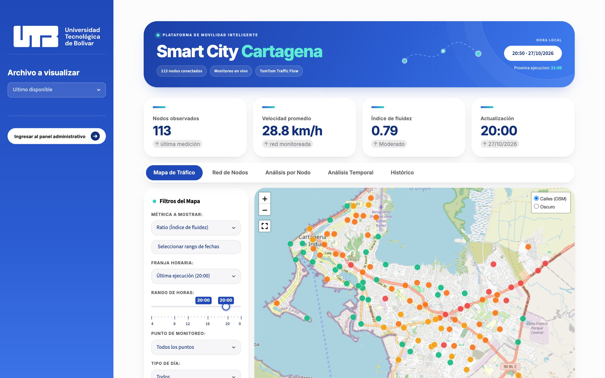
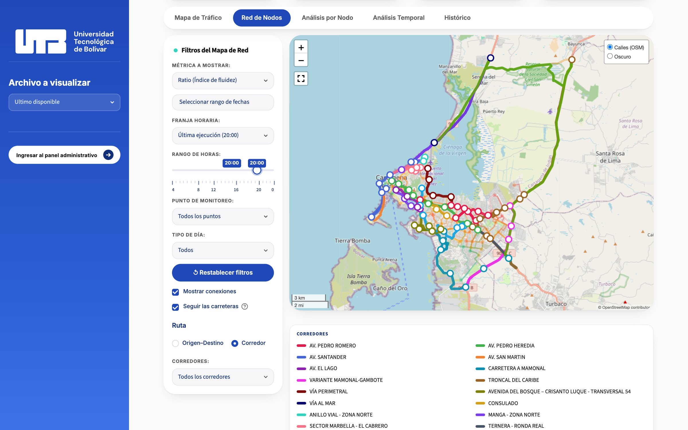
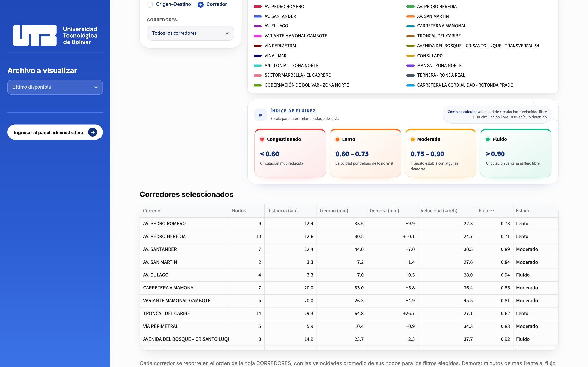
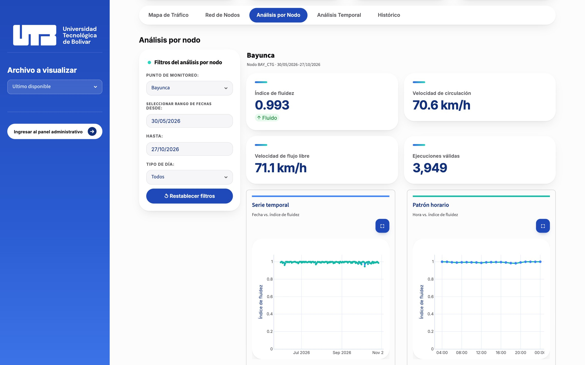
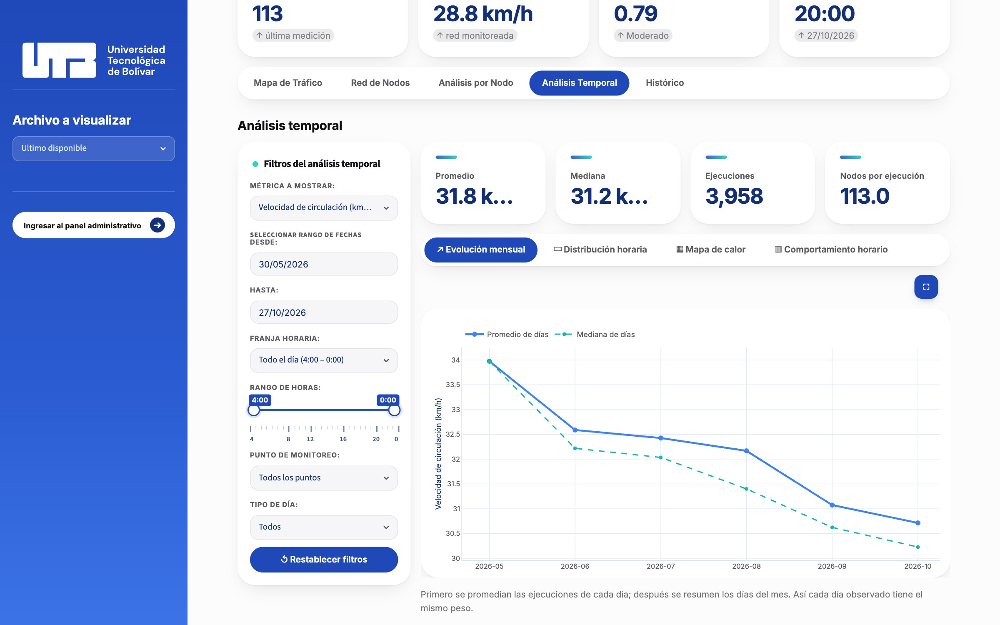
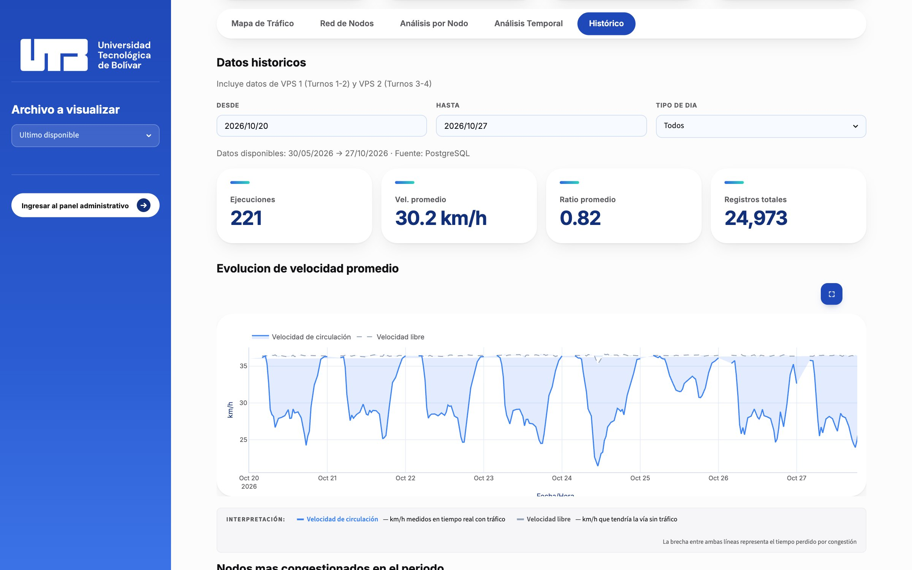

# 🚦 Smart Mobility Cartagena

**Observatorio Académico de Tráfico Urbano** — Universidad Tecnológica de Bolívar

Sistema distribuido que recolecta, almacena y publica datos de tráfico en tiempo real para la ciudad de Cartagena de Indias. Monitorea **113 nodos** sobre las principales vías consultando la **API TomTom Traffic Flow**, y expone los resultados en un tablero web interactivo.

🔗 **Sistema en vivo:** [tomtom-utb.duckdns.org](https://tomtom-utb.duckdns.org)



---

## 📋 Descripción

El sistema implementa un proceso **ETL** (Extract–Transform–Load) que se ejecuta automáticamente **28 veces al día**, repartido entre dos servidores. Cada ejecución consulta la velocidad de circulación en los 113 nodos, calcula indicadores de congestión y persiste los resultados en dos capas de almacenamiento independientes.

### Características

- 🛰️ **Extracción automática** desde TomTom Traffic Flow API (113 nodos)
- ⏱️ **Automatización** con cron en dos servidores VPS (Turnos 1–4, 28 corridas al día)
- 🔑 **Rotación de llaves TomTom** con reservas por servidor y cambio automático cuando una se queda sin saldo
- 💾 **Almacenamiento dual:** Google Sheets/Drive + PostgreSQL
- 📊 **Dashboard interactivo** con cinco vistas (Mapa de Tráfico, Red de Nodos, Análisis por Nodo, Análisis Temporal e Histórico) y un panel administrativo con clave
- 🗺️ **Mapa de nodos con filtros** (métrica, rango de fechas, franja horaria y tipo de día: laborables, fin de semana, quincena o un día) que arranca en la última ejecución, con ventana emergente y foto de Google Street View
- 🕸️ **Red de nodos** con el trazado por vía de cada conexión en los dos sentidos, ruta más rápida origen–destino y **18 corredores** con nombre, filtro, leyenda y resumen de distancia, tiempo y fluidez
- 📍 **Análisis por nodo:** serie diaria, patrón horario, velocidad frente a flujo libre y distribución de la congestión
- 🕒 **Análisis temporal** por corrida del cron (día operativo de 4:00 a 0:00): evolución mensual, distribución horaria, mapa de calor y comportamiento horario, con gráficas ampliables
- 🔥 **Snapshot a Firestore** que alimenta el motor de ETAs de la app TransCaribe
- 📈 **Indicadores de congestión** alineados con el TomTom Traffic Index
- 💰 **Costo de operación:** USD 0.00 (servidores Always Free y APIs dentro de su nivel gratuito)

---

## 🏗️ Arquitectura

```
                    ┌─→ Google Sheets / Drive (respaldo)
VPS 1 ──────────────┤
(Turnos 1-2)        └─→ PostgreSQL ←──────┐
                                          │
VPS 2 ──────────────┬─→ Google Sheets     │ (vía red)
(Turnos 3-4)        └─→ PostgreSQL ────────┘
                              │
                         Dashboard (Streamlit) → Usuario
```

| Servidor | Turnos | Consumo diario |
|----------|--------|----------------|
| **VPS 1** | Turno 1 + 2 (04:00–13:00) | 1.582 llamadas |
| **VPS 2** | Turno 3 + 4 (13:30–00:00) | 1.582 llamadas |

> Cada servidor usa sus propias llaves de TomTom (principales y de reserva) y las rota de forma automática: cuando una se queda sin saldo de créditos pasa a la siguiente (`src/rotacion_llaves.py`).

---

## 🖥️ Dashboard

**Red de Nodos — corredores.** En la ruta "Corredor" se dibujan los corredores de la hoja `CORREDORES` por la vía, cada uno con su color. Debajo del mapa están la leyenda y un resumen con la distancia, el tiempo de recorrido, la demora frente al flujo libre y la fluidez de cada corredor. El filtro permite ver uno o varios. La ruta "Origen–Destino" calcula el camino más rápido entre dos nodos con las velocidades del periodo filtrado.

<p align="center">
  
  
</p>

**Análisis por Nodo y Análisis Temporal.** Indicadores, serie diaria y patrón horario de un nodo; para toda la red o los puntos elegidos, la evolución mensual, la distribución por corrida, el mapa de calor hora × día y el comportamiento horario. Cada gráfica se puede ampliar.

<p align="center">
  
  
</p>

**Histórico.** Evolución de la velocidad de circulación frente a la velocidad libre, nodos más congestionados, mapa de calor hora × día, hora pico frente a hora valle y detalle por nodo.

<p align="center">
  
</p>

**Panel administrativo** (botón de la barra lateral, protegido con clave): resumen operativo de los dos servidores, estado y consumo de las llaves de TomTom, ejecuciones y errores por hora, ocupación del Google Sheet y diagnóstico de la configuración.

---

## 🧰 Tecnologías

| Tecnología | Rol |
|------------|-----|
| Python 3.10 | Proceso ETL y dashboard |
| TomTom Traffic Flow API v4 | Fuente de datos de tráfico |
| Oracle Cloud (2 VPS) | Servidores de ejecución |
| cron + Bash | Automatización |
| Google Sheets / Drive | Almacenamiento documental |
| PostgreSQL 14 | Almacenamiento relacional |
| Firebase Firestore | Snapshot en vivo para la app TransCaribe |
| Streamlit + Plotly + Folium | Dashboard web y mapas |
| TomTom Routing API + OSRM | Red vial entre nodos (captura única) |
| SQLAlchemy + psycopg2 | Acceso a PostgreSQL |

---

## 📁 Estructura del repositorio

```
proyect_r/
├── src/
│   ├── config.py             # Configuración centralizada (variables de entorno)
│   ├── descargar_trafico.py  # Proceso ETL principal; lee las hojas REDES y CORREDORES
│   ├── rotacion_llaves.py    # Rotación y saldo de las llaves TomTom
│   ├── horario.py            # Día operativo (4:00–0:00) y corridas del cron
│   ├── google_upload.py      # Subida/lectura de Google Sheets y Drive
│   ├── db.py                 # Acceso a PostgreSQL (lecturas por rango y promedios por nodo)
│   ├── subir_firestore.py    # Snapshot de tráfico para la app TransCaribe
│   ├── security_utils.py     # Saneo de errores y secretos en los registros
│   └── autorizar_google.py   # Generación del token OAuth (una vez)
├── dashboard/
│   ├── monitor.py            # Dashboard Streamlit
│   ├── mapa_nodos.py         # Filtros, ventana emergente y mapa Folium
│   ├── red_nodos.py          # Red de nodos: conexiones, rutas, corredores y mapa
│   ├── analisis_nodo.py      # Cálculos de la vista Análisis por Nodo
│   ├── analisis_temporal.py  # Agregaciones estadísticas de la vista temporal
│   ├── admin_services.py     # Datos del panel administrativo
│   └── pages/admin.py        # Panel administrativo
├── data/
│   ├── red_nodos.json        # Red vial capturada (distancia y trazado en cada sentido)
│   └── red_nodos_revision.csv# Conexiones donde TomTom y OpenStreetMap no coinciden
├── deploy/
│   ├── run.sh                # Wrapper que ejecuta el ETL
│   ├── crontab_vps1.txt      # Horarios de VPS 1
│   ├── crontab_vps2.txt      # Horarios de VPS 2
│   ├── dashboard.service     # Servicio systemd del dashboard
│   └── backup_postgres.sh    # Respaldo diario de la base
├── tests/                    # Pruebas unitarias (unittest)
├── docs/capturas/            # Capturas del dashboard usadas en este README
├── migrar_a_postgres.py      # Migración Sheets → PostgreSQL (verificada)
├── capturar_geometria.py     # Captura única de la traza real de cada vía
├── capturar_red.py           # Captura de la red vial entre nodos vecinos (TomTom + control OSRM)
├── reparar_columnas_sheet.py # Repara filas del Sheet escritas con un encabezado anterior (diagnóstico por defecto)
├── nodos.xlsx                # Catálogo: NODOS (113 nodos), REDES (vecinos) y CORREDORES
└── requirements.txt          # Dependencias
```

---

## ⚙️ Instalación

```bash
# Clonar el repositorio
git clone https://github.com/Manuuell/Monitor-TraficoCTG.git
cd Monitor-TraficoCTG

# Entorno virtual e instalación de dependencias
python3 -m venv venv
source venv/bin/activate        # Windows: venv\Scripts\activate
pip install -r requirements.txt
```

### Variables de entorno (`.env`)

```bash
TOMTOM_API_KEY=tu_clave_tomtom
VPS_ID=1
SHEET_ID=id_de_tu_google_sheet
DRIVE_FOLDER_ID=id_de_tu_carpeta_drive
SUBIR_A_GOOGLE=true

# PostgreSQL (opcional)
DB_HOST=localhost
DB_NAME=trafico
DB_USER=trafico_user
DB_PASSWORD=tu_clave
GUARDAR_EN_DB=true
FUENTE_DASHBOARD=db

# Firestore (opcional — app TransCaribe)
SUBIR_A_FIRESTORE=true

# Foto del nodo en el mapa (opcional — Street View Static API)
GOOGLE_STREETVIEW_KEY=tu_llave_google
```

---

## ▶️ Uso

**Ejecutar una descarga manual:**
```bash
python3 src/descargar_trafico.py
```

**Levantar el dashboard:**
```bash
streamlit run dashboard/monitor.py
```

**Capturar la geometría de las calles** (una sola vez; queda en `data/nodos_geometria.json` para la futura vista de red de nodos):
```bash
python3 capturar_geometria.py
```

**Capturar la red vial entre nodos** (una sola vez, o cuando cambien las hojas `REDES` o `CORREDORES`; habilita "Seguir las carreteras", las distancias por vía y los corredores de la Red de Nodos):
```bash
python3 capturar_red.py
```
Toma de la hoja `REDES` de `nodos.xlsx` qué nodos son vecinos (y también los nodos seguidos de cada corredor) y de la **Routing API de TomTom** (el mismo mapa de las velocidades) la distancia por vía y el trazado en cada sentido, con las llaves de `TOMTOM_API_KEYS_RED` o, si está vacía, las del ETL. Como control compara con OpenStreetMap (OSRM) y deja en `data/red_nodos_revision.csv` las conexiones donde no coinciden, con enlaces a Google Maps para revisarlas. Guarda `data/red_nodos.json`. Opciones:

| Opción | Qué hace |
|--------|----------|
| `--fuente osrm` | Captura todo con OpenStreetMap, sin gastar créditos |
| `--resolver` | Vuelve a pedir con la ruta más corta las conexiones donde TomTom y OpenStreetMap no coinciden (la más rápida a veces da rodeos entre nodos vecinos) |
| `--completar-vuelta` | Agrega el trazado de vuelta a las conexiones que no lo tienen, con la distancia de esa misma consulta. Ida y vuelta pueden ir por calzadas distintas aunque midan lo mismo |
| `--completar-corredores` | Agrega a la red los pares de nodos seguidos de un corredor que todavía no son conexiones |
| `--capturar-trazados-corredor` | Captura con TomTom pedestrian shortest una geometría sin sentido para los tramos de corredor que dan una vuelta en auto. Guarda `path_corredor` y `d_corredor_m` sin modificar las rutas Origen–Destino |

**Corredores:** se definen en la hoja `CORREDORES` de `nodos.xlsx`, una fila por nodo con las columnas `Corredor`, `Orden` e `id_nodo` (el recorrido sigue la columna `Orden`). Después de agregar o cambiar un corredor, `python3 capturar_red.py --completar-corredores` captura los tramos nuevos. Los overrides `path_corredor` y `d_corredor_m` solo afectan el dibujo y el resumen del corredor; `path`, `path_ba`, `d_ab_m` y `d_ba_m` siguen siendo la fuente exclusiva de las rutas Origen–Destino.

**Correr las pruebas:**
```bash
python3 -m unittest discover -s tests
```

**Automatizar con cron** (instalar la tabla de horarios):
```bash
crontab deploy/crontab_vps1.txt
```

---

## 💾 Capas de almacenamiento

Cada ejecución escribe en varias capas independientes. Si una falla, el ETL
continúa y las demás conservan el dato.

| Capa | Contenido | Rol |
|------|-----------|-----|
| **PostgreSQL** | Histórico completo | Fuente de lectura del dashboard (`FUENTE_DASHBOARD=db`) |
| **Google Sheets** | Histórico fila por fila | Respaldo documental y consulta manual |
| **Google Drive** | Un CSV por ejecución + volcado diario de la base | Copia off-site |
| **Firestore** | Solo el último snapshot (`traffic/latest`) | Velocidades en vivo para la app TransCaribe |

> ⚠️ Google limita cada hoja de cálculo a **10 millones de celdas**. El panel
> administrativo muestra el porcentaje ocupado, porque al llegar al límite las
> escrituras a Sheets fallan en silencio.

---

## 📊 Indicadores

| Indicador | Fórmula | Significado |
|-----------|---------|-------------|
| **Ratio de velocidad** | `currentSpeed / freeFlowSpeed` | 1.0 = sin tráfico · 0.0 = detenido |
| **Índice de congestión** | `100 × (currentTT − freeFlowTT) / freeFlowTT` | % de tiempo adicional por tráfico |

**Clasificación:**

| Nivel | Ratio | Estado |
|-------|-------|--------|
| 🟢 Fluido | > 0.90 | Circula cerca de velocidad libre |
| 🟡 Moderado | 0.75 – 0.90 | Reducción leve |
| 🟠 Lento | 0.60 – 0.75 | Congestión apreciable |
| 🔴 Congestionado | < 0.60 | Velocidad muy reducida |

**Horario:** el día operativo va de 4:00 a 0:00 y tiene 28 corridas (cada hora y cada media hora en las horas pico). Las franjas del dashboard son Madrugada (4:00–5:00), Hora pico AM (5:30–7:30), Mañana (8:00–11:00), Medio día (12:00–13:30), Tarde (14:00–16:00), Hora pico PM (17:00–18:30) y Noche (19:00–0:00).
